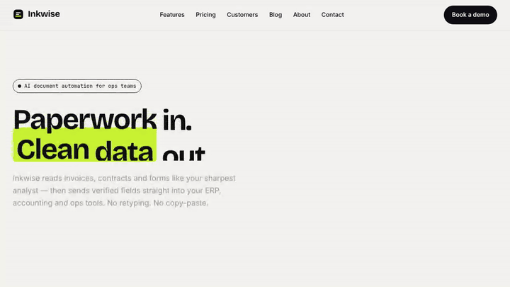
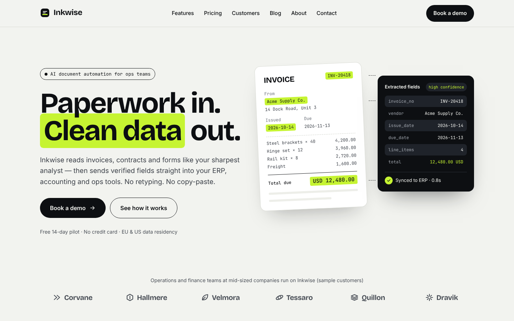
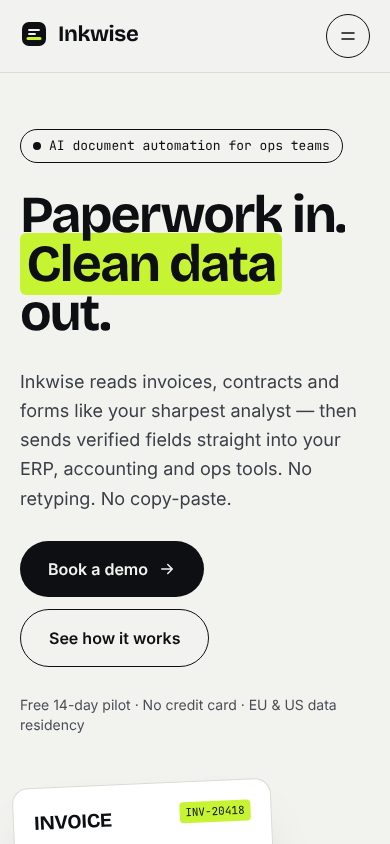
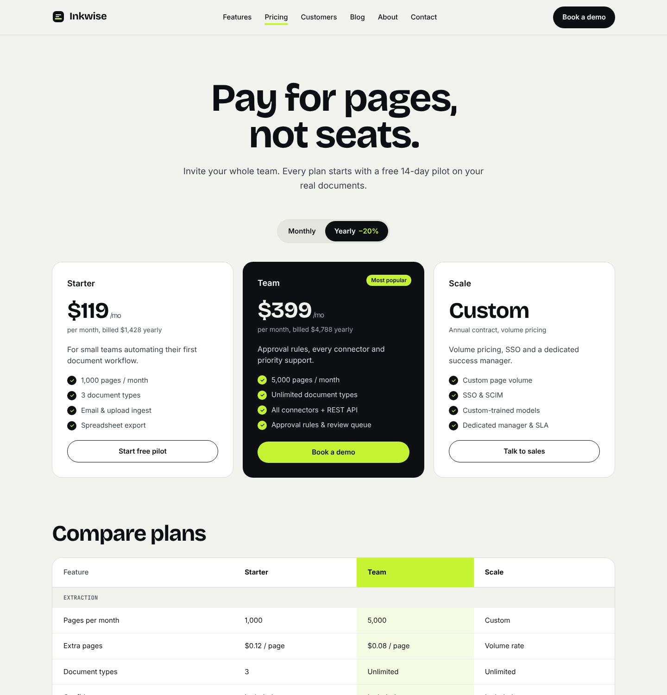
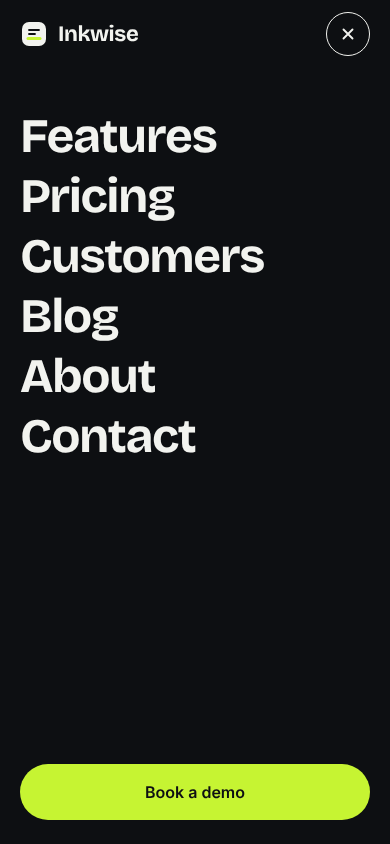
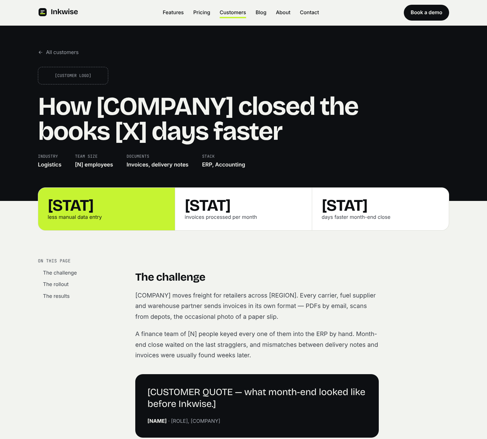

# Inkwise — animated marketing site

A multi-page marketing website for **Inkwise**, a fictional AI tool that extracts data from invoices, contracts and forms. Built as a portfolio piece to show design-to-code work: one memorable scroll-driven motion moment, restrained animation everywhere else, and production-grade accessibility, SEO and testing.

> **Note:** Inkwise is a concept brand. The customers (Corvane, Hallmere, Velmora…), people, quotes and figures are invented samples and are labelled as such on the site. Logos and document illustrations are original SVGs; avatars are monograms, not photos of real people.



| Desktop                                                                       | Mobile                                                      |
| ----------------------------------------------------------------------------- | ----------------------------------------------------------- |
|                       |       |
|    |  |
|  |                                                             |

## Live Demo

- 🌐 **Website:** https://inkwise-zeta.vercel.app
- 🎬 **Video walkthrough:** https://youtu.be/6TthyjUtT3U

[](https://youtu.be/6TthyjUtT3U)
---

## Tech stack

| Area      | Tools                                                                              |
| --------- | ---------------------------------------------------------------------------------- |
| Framework | Next.js 15 (App Router, static generation), React 19, TypeScript (strict)          |
| Styling   | Tailwind CSS v4 (CSS-first design tokens)                                          |
| Motion    | GSAP 3 + ScrollTrigger (code-split), Lenis smooth scroll, CSS keyframes            |
| Content   | MDX via `@next/mdx` with typed `meta` exports                                      |
| Forms     | React Hook Form + Zod                                                              |
| Fonts     | Fontsource files, loaded with `next/font/local` (no Google Fonts requests)         |
| Testing   | Vitest + Testing Library, Playwright (Chromium, Firefox, WebKit, mobile), axe-core |
| Quality   | ESLint (`next/core-web-vitals`), Prettier, GitHub Actions CI                       |

## Features

**Pages:** Home, Features, Pricing, Customers (list + MDX case studies), Blog (list + MDX articles), About, Contact, Privacy notice and a branded 404.

**Motion**

- **Hero (the one big moment):** headline words rise out of a mask, a highlighter "scan bar" sweeps the invoice, each field lights up and connects to the Extracted panel, then a "Synced" chip pops. Plays once, about 2.4 seconds.
- **Pinned scroll story:** "How it works" pins on desktop while scrolling advances three steps and fills in the document fields.
- **Horizontal scroll section:** document types move sideways while you scroll down (desktop); native swipe with scroll-snap on touch devices.
- **Custom text split:** no SplitText plugin. `splitNodes` splits headlines on the server for CSS entrance animations; `splitWords` splits below-the-fold headlines in the browser for scroll-triggered reveals.
- Lenis smooth scroll, an ink-panel page transition, magnetic primary buttons, hover/focus previews on integration tiles.
- **`prefers-reduced-motion`:** GSAP is not even downloaded, Lenis stays off, CSS animations are disabled and every section renders in its final state.
- **Mobile:** pins and magnetic effects are switched off and heavy effects are simplified.

**Other functionality**

- Monthly/yearly billing toggle, plan comparison table, FAQ accordion
- Blog search and topic filter, reading-progress bar, table of contents, copyable code blocks
- Contact form with validation, submitting, success and error states, plus a consent checkbox linked to the privacy notice. Nothing is sent; use an address ending in `@fail.test` to see the error state.
- Newsletter signup with inline validation that is announced to screen readers
- SEO: per-page metadata and canonical URLs, generated Open Graph images (per page and per MDX entry), `sitemap.xml`, `robots.txt`, JSON-LD (Organization, WebSite, FAQPage, BlogPosting)

## Getting started

Requirements: Node.js 20.9+ (see `.nvmrc`).

```bash
npm install
cp .env.example .env.local   # optional: set site URL and author link
npm run dev                  # http://localhost:3000
```

| Script                            | What it does                                            |
| --------------------------------- | ------------------------------------------------------- |
| `npm run dev`                     | Development server                                      |
| `npm run build` / `npm start`     | Production build / serve it                             |
| `npm run lint`                    | ESLint                                                  |
| `npm run typecheck`               | TypeScript, no emit                                     |
| `npm run format` / `format:check` | Prettier write / check                                  |
| `npm test`                        | Unit and component tests (Vitest)                       |
| `npm run test:e2e`                | Playwright end-to-end tests (run `npm run build` first) |

The first time you run end-to-end tests, install the browsers with `npx playwright install`.

### Environment variables

| Name                     | Purpose                                                                    |
| ------------------------ | -------------------------------------------------------------------------- |
| `NEXT_PUBLIC_SITE_URL`   | Absolute URL used for canonical links, Open Graph, the sitemap and JSON-LD |
| `NEXT_PUBLIC_AUTHOR_URL` | Link for the footer credit (your portfolio or Upwork profile)              |

## Project structure

```
src/
├── app/                    # Routes (App Router), metadata, OG images, sitemap, robots
│   ├── blog/[slug]/        # MDX article pages (SSG)
│   └── customers/[slug]/   # MDX case-study pages (SSG)
├── components/
│   ├── ui/                 # Design-system primitives: Button, Accordion, form fields, icons…
│   ├── layout/             # Header, mobile menu, footer, skip link
│   ├── sections/           # Page sections, grouped by page (home, pricing, blog…)
│   ├── motion/             # MotionScene, SmoothScroll, PageTransition, WordReveal, SplitReveal, Reveal
│   ├── mdx/                # Components available inside MDX
│   └── seo/                # JSON-LD renderer
├── content/                # MDX: blog posts and customer stories
├── lib/
│   ├── motion/             # GSAP loader, useMotion hook, scenes, split utilities, media queries
│   ├── content/            # Typed MDX loaders, slugify, date formatting
│   ├── pricing.ts          # Plans, comparison data and price helpers
│   └── contact-schema.ts   # Zod schema + fake submit
└── mdx-components.tsx
e2e/                        # Playwright specs
docs/screenshots/           # README media
```

## Design decisions

- **"Ink & Highlighter" visual language.** Paper background, ink-black type and a single highlighter-lime accent. The highlighter is used for one thing: marking extracted data. It shows up as the product metaphor throughout (headline marker, highlighted invoice fields, active states). All text pairs meet WCAG AA (ink on paper 17.2:1, ink on highlighter 15:1, muted on ink 8:1).
- **One strong motion moment, the rest restrained.** The hero tells the product story in about 2.4 seconds. Elsewhere, motion only supports reading: quiet fade-ups, one pinned story, one horizontal section.
- **Animation never blocks content.** Headlines are split on the server and animated with CSS from the first paint, so the largest contentful paint is not held back by JavaScript. GSAP and ScrollTrigger are code-split and loaded right after mount (hero) or when the browser is idle (below the fold).
- **Leak-free route changes.** Every animation goes through one hook, `useMotion`, which runs inside `gsap.context()` + `gsap.matchMedia()` scoped to its component. Unmounting (or a breakpoint or motion-preference change) reverts all tweens, ScrollTriggers and pin spacers. An e2e test navigates between routes and asserts that no pin spacers or runtime errors remain.
- **Server Components for markup, tiny controllers for motion.** Animated home sections stay Server Components; a render-less `<MotionScene scene="howItWorks" target="how-it-works" />` attaches the matching setup from `lib/motion/scenes.ts`. React doesn't ship or run component code for the section markup itself.
- **Reduced motion is a first-class path.** An inline script adds `motion-ok` to `<html>` only when motion is allowed. Every pre-hidden state is scoped to that class, with a CSS fallback that reveals content if JavaScript never runs.
- **Light theme only, on purpose.** The brand is built on "ink on paper" with a highlighter accent, and the marker metaphor depends on that contrast. Dark surfaces are used as sections (hero panels, 404, mobile menu) instead of a site-wide dark mode, which keeps a single, fully tested colour system.
- **Native platform first.** The mobile menu uses `<dialog>` (focus trap and Escape for free), the accordion uses ARIA disclosure buttons with CSS grid-row height easing, toggles use `aria-pressed`, and tables keep sticky row headers inside a focusable scroll region.
- **Content as data.** MDX files export a typed `meta` object, so list pages, tables of contents, OG images, sitemap entries and JSON-LD are all generated from the same source.
- **Frontend only.** There is no backend; the contact form resolves through a fake `submitContact` with a configurable failure case, so every UI state can be demoed and tested.

## Quality

Measured locally on production builds:

| Check                                                                           | Result                                                                                                                                                 |
| ------------------------------------------------------------------------------- | ------------------------------------------------------------------------------------------------------------------------------------------------------ |
| Lighthouse, desktop (Home, Features, Pricing, case study, Blog, About, Contact) | Performance 100 · Accessibility 100 · Best Practices 100 · SEO 100                                                                                     |
| Lighthouse, mobile (simulated slow 4G + 4× CPU)                                 | Accessibility 100 · Best Practices 100 · SEO 100; Performance 85–95 on Home in a shared container (varies run to run) — re-check on PageSpeed Insights |
| Unit/component tests                                                            | 55 passing                                                                                                                                             |
| End-to-end tests                                                                | Chromium + mobile passing locally; Firefox and WebKit run in CI                                                                                        |
| axe-core (WCAG 2.1 AA)                                                          | No serious or critical violations on key pages                                                                                                         |

## My contribution and problems solved

I designed and built the whole project on my own: visual language, page layouts, components, motion, content model, tests, CI and deployment. These are the problems that took the most work:

- **Rich animation without hurting Core Web Vitals.** The first version loaded GSAP during hydration and held back the largest contentful paint. I moved headline reveals to CSS on server-split text and code-split GSAP. Scenes below the fold, and the hero document on mobile, now load it only when the browser is idle. Mobile Total Blocking Time dropped from about 500 ms to about 200–300 ms, and desktop scores 100.
- **Animations leaking between routes.** Pinned ScrollTriggers left spacer elements and stale triggers after client-side navigation. Every animation now goes through one hook (`useMotion`) that scopes and reverts its own context. An end-to-end test navigates between routes and fails if any pin spacer or runtime error remains.
- **Reduced motion as a real path, not an afterthought.** For visitors who prefer reduced motion, the GSAP and Lenis code is never downloaded, and every section renders in its final state. Content still shows if JavaScript fails, thanks to a CSS fallback.
- **One source of truth for content.** MDX files export typed metadata that feeds list pages, tables of contents, OG images, the sitemap and JSON-LD. A unit test checks that each table of contents matches the article's headings, so links can't silently break.
- **Accessibility checked automatically.** axe-core runs on every key page in CI, alongside keyboard tests for the skip link, mobile menu, accordion and forms.

## Deployment

Live at **[inkwise-zeta.vercel.app](https://inkwise-zeta.vercel.app/)**. The site is fully static and deploys to Vercel with zero configuration. Set `NEXT_PUBLIC_SITE_URL` to the production URL so canonical links, Open Graph images and the sitemap point to the right domain. If it is not set, the Vercel production domain is used automatically.

---

Designed and built by **Sherali Kuziyev**.
